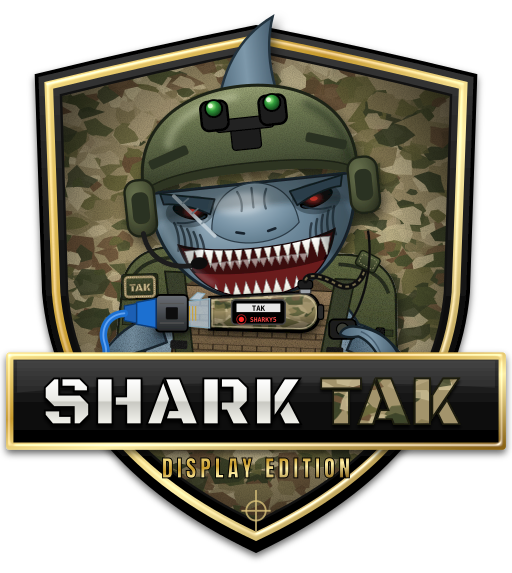

# SharkTAKDisplay – TAK payloads for the [Shark Jack Display](https://hak5.org/products/shark-jack-display)

<p align="center"></p>

[](https://www.buymeacoffee.com/sect0101)

Community payloads that connect the **Hak5 Shark Jack Display** to the **TAK** ecosystem (ATAK, WinTAK, iTAK, WebTAK, CloudTAK) over Cursor-on-Target.

**Payloads here are written in DuckyScript™ + Bash for the Shark Jack Display. They are community payloads and are not supported or guaranteed by Hak5.** See [Legal](#legal).

Also see [PagerTAK](https://github.com/SECT0101/PagerTAK) for the WiFi Pineapple Pager and [PineappleTAK](https://github.com/SECT0101/PineappleTAK-MK7) for the WiFi Pineapple Mark VII.

The layout follows the official [hak5/sharkjackdisplay-payloads](https://github.com/hak5/sharkjackdisplay-payloads) library. Each payload is a single `payload.txt`, so a folder can be copied straight to the Shark Jack, installed with Hak5's *Get PR* payload, or submitted upstream as a pull request.

---

## Payloads

| Payload | Category | Description |
|---|---|---|
| [SharkTAKDisplay](payloads/library/recon/SharkTAKDisplay) | recon | Wired network survey to TAK. It covers the network fingerprint (DHCP with rogue DHCP detection, LLDP/CDP switch, port and VLAN, SNMP location, public IP), nmap host and service discovery, a per-network baseline diff for new or rogue devices, and packet capture. Results go out as a CoT marker with the summary in the remarks, plus a data package with the full results attached to the marker. You can send to one TAK contact or everyone, or upload to the TAK Server, and results queue when the server can't be reached. Location comes from LLDP-MED, your own ATAK position from the TAK Server, saved sites, switch location text, or public IP geolocation. TLS 8089 / TCP 8087 / UDP. |

## Repository layout

```
payloads/
└── library/
    └── recon/
        └── SharkTAKDisplay/
            ├── payload.txt     # the whole payload (Bash + Shark Jack Display DuckyScript)
            └── README.md       # setup, usage, settings, location methods, files
docs/
└── logo.png                    # TAKtical Sharky
.github/
├── FUNDING.yml                 # Buy Me a Coffee (Sponsor button)
└── workflows/                  # shellcheck on every push; release zip on every v* tag
```

Your certificates, queue and baselines live on the device under `/root/sharktakdisplay/`, outside the payload folder, so updating the payload never touches them.

## Requirements

- Shark Jack Display (nmap, curl and lldpd are on it already)
- A TAK Server, plus a client certificate for TLS (or enroll on the device with a TAK username)
- Packages from *Settings > Install Packages* (one press, needs internet - do it at home before deploying)
- Easiest setup: copy your ATAK connection package (`.zip`) to `/root/sharktakdisplay/certs/`, then run *Settings > Setup Check*

## Legal

Use these payloads only on networks you own or are explicitly authorized to assess. You are responsible for complying with all applicable laws and policies. DuckyScript is a trademark of Hak5 LLC. This project is not affiliated with or endorsed by Hak5 or the TAK Product Center.

## License

[GPL-3.0](LICENSE)
